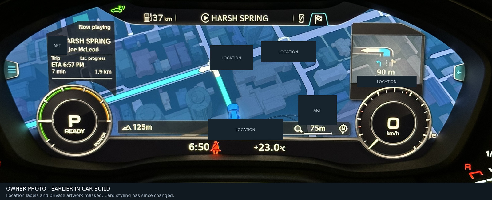
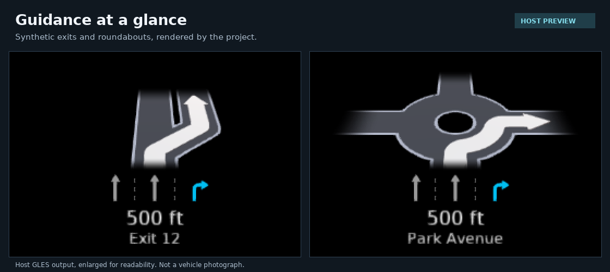
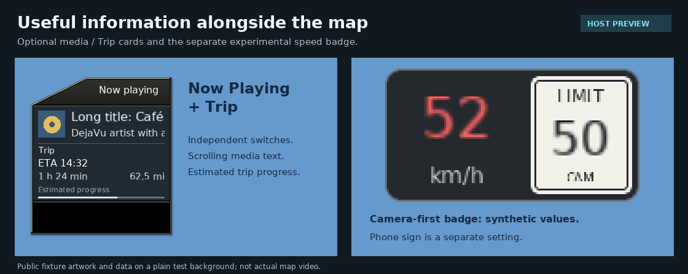
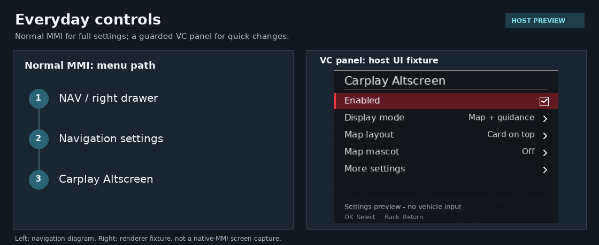

# Carplay Altscreen for Audi Q5

**CarPlay maps, turn-by-turn guidance and useful information in the Virtual Cockpit,
with everyday controls in normal MMI and the steering-wheel menu.**

This personal fork brings AltScreen video and Route Guidance Integration (RGI)
together in **one source-built package and one installer**, with Q5-specific
settings, overlays and recovery work.

**Target:** 2020 Audi Q5 · `MHI2Q_US_AUG22_P5145` · MU1316 · iPhone / CarPlay

**Development branch:** [`q5-mu1316-build-fixes`](https://github.com/lindayi/mib2-carplay-rgi-altscreen/tree/q5-mu1316-build-fixes)

[In-car photo](#an-earlier-in-car-build) · [Features](#what-you-get) · [Controls](#everyday-controls) ·
[Installation](#installation) · [Build](#build) · [Status and limits](#status-and-limits) ·
[Documentation](#documentation)

> [!WARNING]
> This is not a universal Audi retrofit or a plug-and-play firmware download.
> The HMI patch and installation guards target the exact firmware above.
> Installation modifies head-unit software and system configuration; keep verified
> originals and stop on any failed guard. Do not substitute another firmware's JAR.

## An earlier in-car build

*Owner-supplied photo from September 2026 testing. The card styling has since
changed; this is not validation of the current performance candidate. The photo
is cropped, metadata removed, and location labels/private artwork masked.*

## What you get

AltScreen supplies the **phone's cluster video**. RGI supplies **maneuvers, lanes
and route information**. They are separate inputs, coordinated here rather than
installed as competing patches.

| Feature | In this fork |
| --- | --- |
| Maps and guidance | Choose CarPlay map + guidance, CarPlay map only, or Audi map + guidance. |
| Maneuver panel | 3D arrows, lane guidance, distance to the next turn and next-road/exit text; appearance and scrolling controls. |
| Phone presentation | Top/right/left maneuver cards, map-only and original layout, plus phone ETA and sign choices. |
| Information cards | Optional Now Playing and Trip cards, an estimated trip-progress bar, and an experimental camera-first speed/limit badge. |
| Everyday controls | Native MMI settings, a guarded VC quick-settings panel, roller zoom and optional touchpad navigation. |
| MMI integration | Parking-popup, phone/call and media integration, while retaining native emergency-call priority. |
| Diagnostics and recovery | Export without restoring, transactional installation, retained originals and an explicit no-SD performance-recovery action. |

### Guidance at a glance

*Real renderer output with synthetic route data. These are enlarged host previews,
not vehicle photographs or proof of final cockpit placement.*

### Optional information alongside the map

Now Playing and Trip can be enabled independently. Cards, the speed/limit display
and map mascots default **Off**. Trip progress is an estimate from the first
remaining distance observed in a route, not a measurement of the entire journey.

The custom speed badge and **Phone sign** are different choices: the former uses
Audi-derived data; the latter requests the navigation app's own rendered sign.
Neither is an authoritative source of the legal speed limit.
[Card and speed-source details](docs/hmi/carplay-settings.md#optional-map-cards).

Optional mascots use locally supplied packs. Public builds contain no character
artwork; an original CC0 demo can be generated for development.
[Pack creation and licensing](docs/hmi/carplay-settings.md#optional-map-mascots).

## Everyday controls

**Normal MMI:** NAV → right drawer → Navigation settings → **Carplay Altscreen**

**Virtual Cockpit:** in large-map View with live CarPlay video, use a roller zoom
detent to establish eligibility, then long-press the roller to open quick settings.
This is an experimental project panel, not a replacement Audi drawer.
Outside the panel, the roller provides map zoom and the configured Road/Trip action.

*The left side is a navigation diagram; the right side is a host UI fixture.
Neither is a photograph of the native MMI screen.*

| Change | When it applies |
| --- | --- |
| Appearance, media/Trip cards, card-to-card position | Live where the current session supports it. |
| Phone map/card profile, phone ETA, entering/leaving Phone sign | Requires a CarPlay reconnect. The menu tells you when one is needed. |
| Master Off | Releases project cockpit features live; the extra-stream/preload bypass takes effect next CarPlay session. It is not an uninstall. |

**Changing a preference never requires a full MMI reboot or silently disconnects
the phone.** Installation is different and does require the reboot below.
See [all settings](docs/hmi/carplay-settings.md) and
[VC controls and eligibility](docs/hmi/vc-quick-settings.md).

## Installation

For an exact-target unit that **already has MIB2 Toolbox installed**, use the
complete package built from this fork. Presentation modes are settings, not
separate installation variants.

1. **Back up the card.** Copy and hash-verify all files, including hidden files
   except Windows `System Volume Information`. Retain earlier recovery data.
2. **Prepare the card.** Merge the contents of the verified staged package into
   the SD root. Do not format or delete unrelated data. Preserve
   `MMI-Cockpit-Carplay` backups/logs/state and `Dump`; verify copied and untouched files.
3. **Park with stable power and disconnect the iPhone.** Insert the card and run
   **Toolbox → Update Toolbox** to refresh the scripts and Green Menu.
4. Select **MMI-Cockpit-Carplay → INSTALL** and wait for the **final PASS**.
   INSTALL includes boot-only START arming; a separate START step is not required.
5. Perform **one full MMI reboot**, then reconnect the iPhone.

> [!IMPORTANT]
> **Stop on FAIL. Do not use the red Software Update menu for this Toolbox upgrade.**
> Current source includes Maps30 selection and exact-file decoder/MCD performance
> changes. The stock-file changes affect head-unit video/media handling, activate
> after reboot and are not undone by Master Off.
> [Performance scope and recovery](docs/upstream-baseline.md#stock-file-ownership-and-recovery).

These steps are not instructions for first-time Toolbox installation or a firmware
upgrade. Follow the [package instructions](altscreen/SD_CARD_README.txt) and keep the
matching card/originals available for recovery.

## Status and limits

| Evidence | What it establishes |
| --- | --- |
| Earlier vehicle use | Owner reports confirm working features on earlier builds, including navigation labels and repaired menus/mascots. Those reports predate the current performance candidate and are not exhaustive acceptance tests. |
| Current source | Includes the V3.8 Fix1 integration, compatible Luka ports and reviewed installation/recovery fixes. |
| Host validation | Native/Java suites, renderer previews, QNX cross-build and staged installation/rollback/rescue tests provide software evidence, not execution of the complete QNX/vehicle path. |
| Current performance candidate | Prepared for a vehicle trial; its Maps30, reduced decoder queues, MCD behavior and new recovery path are not yet vehicle-validated. |

Known limits worth reading before use:

- **Google Maps centering can be intermittent.** Layout reapplication exists, but
  it is not a confirmed universal fix or a direct vehicle-marker positioning API.
- **App support varies.** Map video does not guarantee maneuver data, lanes, ETA
  or a phone-rendered speed sign. See [route-guidance compatibility](docs/rgd/rgd-activation.md).
- **Physical placement and input coexistence need real-car checks.** Host images
  do not establish Audi dial clearance, VC input ownership or wireless-adapter behavior.
- **Source availability is not full openness.** Some native components have
  noncommercial terms; private platform inputs are still required.

## Build

The complete build needs Docker, the QNX 6.5 ARMv7 toolchain and a conversion of
the exact unit's original `lsd.jxe`. OEM firmware/JARs and private artwork are not
included in this repository.

Start with the **[Q5 build and validation guide](docs/deploy/build.md)**.
It covers the required inputs, complete SD staging, Windows constraints and
the test commands. Building a package and copying it to an SD card are separate steps.

For code navigation: [architecture](docs/architecture.md),
[source baseline and local adapters](docs/upstream-baseline.md), and
[contributor working agreements](AGENTS.md).

## Logging and recovery

| Need | Use |
| --- | --- |
| Collect diagnostics without changing the installation | **EXPORT DIAGNOSTICS ONLY (no restore)** in the Green Menu. |
| Restore installed software/configuration | **RESTORE ORIGINAL**, with the matching card and backups. This is not a downgrade to a previous AltScreen version. |
| Recover when a performance regression prevents SD discovery | **RESCUE: restore performance originals (no SD)**, if the installed kit and Green Menu are available. It restores only the decoder/MCD files, not the whole installation. Reboot after PASS. |
| Repair/reverse an interrupted transaction | Follow the [guarded transaction/rescue instructions](docs/upstream-integration.md#installation-and-rescue), not an improvised manual copy. |

**STORE LOGS + RESTORE really restores.** Do not use it merely to collect evidence.
Raw diagnostic exports can contain destinations, device details and other private
data. Keep them local; share only reviewed/redacted excerpts.

For an issue report, include the firmware/build ID, iOS and navigation-app versions,
wired/adapter connection, selected mode, and a parked reproduction sequence.
Distinguish what happened on the car from what a host fixture showed.

## Documentation

- [Settings, live/reconnect rules and optional overlays](docs/hmi/carplay-settings.md)
- [Steering-wheel behavior and parked acceptance checks](docs/input/steering-wheel.md)
- [Upstream integration, retained policies and evidence](docs/upstream-integration.md)
- [Technical knowledge index](docs/INDEX.md) — includes revision-specific reverse-engineering notes
- [Preview provenance and regeneration](assets/readme/README.md)

## Credits and licensing

Built on the work of
[yuedizhibo / MHI2Q-CarPlay-AltScreen](https://github.com/yuedizhibo/MHI2Q-CarPlay-AltScreen),
[Luka / mib2q-carplay-rgi](https://github.com/luka-dev/mib2q-carplay-rgi), and
[Allemon / mib2-carplay-rgi-altscreen](https://github.com/Allemon/mib2-carplay-rgi-altscreen).
This fork keeps upstream attribution while documenting its own controls,
MU1316 adapters and validation limits.

Licensing is component-specific: the RGI source baseline is GPL; the independent
AltScreen native pair uses [PolyForm Noncommercial and additional terms](altscreen_native/NOTICE.md).
Keep the [DejaVu font notice](Toolbox/carplay_alt_screen/rgi_renderer/src/LICENSE.DEJAVU)
and [card CJK font license](map_cards/LICENSE.OFL) with relevant distributions.
Repository/source licenses do not grant rights to redistribute private firmware,
vehicle captures or third-party mascot artwork.
